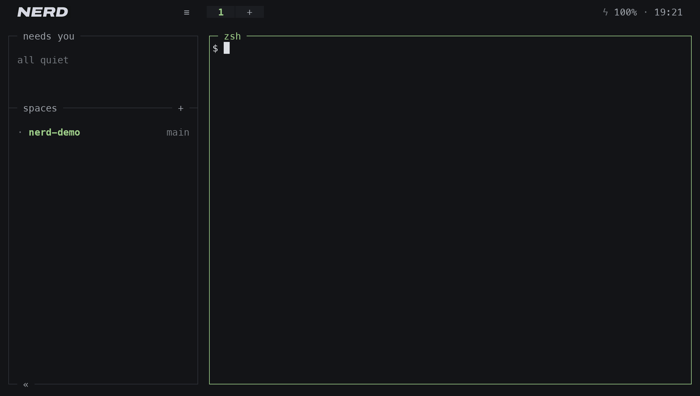

<div align="center">

<h1>
  <picture>
    <source media="(prefers-color-scheme: dark)" srcset="brand/nerd-logo-dark.svg">
    
  </picture>
</h1>

**A terminal multiplexer that shows what your AI agents are doing.**

[](https://www.rust-lang.org)
[](#requirements)
[](docs/privacy-and-security.md)
[](LICENSE)

[Website](https://nerdterm.dev)



</div>

nerd runs your shells and coding agents side by side in panes and tabs, inside the terminal you already use. Its sidebar shows which agent is working, which is waiting for you and which has finished.

- **See which agent needs you.** nerd recognises Claude Code, Codex, Gemini CLI, Copilot CLI, Cursor, OpenCode, Qwen Code, pi and 13 other agents by their process name. With nerd's hook, those eight report their exact state, and most name the tool they ask to run; the others are read from what they print. nerd shows that an agent is asking; the answer stays yours, in the agent.
- **Decide what each pane can reach.** A pane runs as you, with your files and your network, until you narrow it. **Isolation…** keeps a pane to its folder, to the hosts of the agents you choose, or to another macOS account. Messages between agents pass through nerd, under fixed limits and routes that only you change. A plugin shows what it can do before you install it.
- **See every way out of nerd's own code.** No telemetry; nerd checks for updates only if you allowed it, and logs every check. The server runs in a macOS sandbox with networking denied. Every way out of nerd's own code is listed in [What leaves nerd](docs/privacy-and-security.md#what-leaves-nerd), starts from something you do or approved, and writes a line to the log.
- **A file tree beside the panes.** It shows git changes, searches file contents, and previews files with highlighting and images; an SVG shows its picture, and a click on **Source** in the preview's header its text.
- **One search for everything.** `⌥`+`O` finds a pane, a command, a setting, a plugin, a file, a help section or a line a pane printed earlier. Plain switches and installed plugins turn on and off in the result; anything that changes what a pane can reach opens its own window or Settings, never changes in place.

Panes live in a background server. Close the window or restart the Mac, and the layout, folders and pane text come back; agents that support it resume their sessions. Every action is in a right-click menu; keys only repeat them.

## Installation

```sh
curl -fsSL https://nerdterm.dev/install.sh | sh
```

The script downloads the latest release, checks that nerd's release key signed its checksum and that the archive matches it, installs `nerd` into `~/.local/bin` and, if that folder is not on your `PATH`, adds it in `~/.zshrc`. It refuses a release older than the nerd already installed. Run it again to upgrade. `NERD_BINDIR` installs somewhere else. To install an archive you already have, run `sh install.sh nerd-….tar.gz` with its `.sha256` and `.sha256.sig` beside it; without them the script refuses unless `NERD_INSTALL_UNVERIFIED=1` is set, and a signature that does not check is refused either way. An older archive given this way installs: that is how to go back to a release.

Or with Homebrew, upgraded with `brew update && brew upgrade nerd`:

```sh
brew install nerdterm/tap/nerd
```

Keep one of the two: with both, the one earlier on your `PATH` runs, usually `~/.local/bin`.

<details>
<summary>Build from source</summary>

```sh
git clone https://github.com/nerdterm/nerd.git
cd nerd
cargo build --release
install -m 755 target/release/nerd ~/.local/bin/nerd
codesign --force --sign - ~/.local/bin/nerd
```

Use `install`, not `cp`: macOS caches code signatures by inode and kills a binary overwritten in place.

</details>

## Quick start
<!-- summary: Start nerd in a project, split panes, run an agent, and see which agents nerd reads exactly. -->

```sh
cd ~/code/my-project
nerd
```

- Right-click a pane and choose **Split right** or **Split down**.
- Start an agent in a pane, for example `claude`. The sidebar shows its state. When it finishes or asks you something, it moves up into **needs you**.
- Click **≡** at the top of the sidebar for the main menu: the file tree, new spaces, settings, plugins and the rest.
- Right-click a pane and choose **Isolation…** to limit what its program can reach.
- Close the window whenever you like. `nerd` brings it back; `nerd --new` starts another server with a desktop of its own.
- **Servers…** in the main menu lists every server on this Mac, the one you are on first, and opens, renames, updates, stops and removes them. Machines you add to `remotes` in config.json are listed there too, over ssh, when you open them.

### Supported agents

For exact states, install nerd's hook from **Settings… → Agent hooks**, or run `nerd --install-hook`. It goes into every supported agent whose config folder exists. Before it writes into an agent for the first time, it shows the agent, its settings file and the command it resumes with, and asks. When an agent's resume command changes, a restored pane stops typing it until you confirm it again with `nerd --install-hook`. When nerd starts, it brings a hook an older nerd installed up to date; it never adds one to an agent you did not hook.

| Agent | Config | States and needs you | Subagents | Resumes after a restart with |
|---|---|---|---|---|
| Claude Code | `~/.claude/settings.json` | Yes, with the tool it asks for | Rows with their tools and runs | `claude --resume=<id>` |
| Codex | `~/.codex/hooks.json` | Yes, with the tool it asks for; no failed calls | Rows, without a task | `codex resume <id>` |
| Qwen Code | `~/.qwen/settings.json` | Yes, with the tool it asks for | Rows with their tools | `qwen --resume <id>` |
| Copilot CLI | `~/.copilot/hooks/nerd.json` | Yes, with the tool it asks for | Rows only; the general-purpose subagent does not report | `copilot --resume <id>` |
| OpenCode | `~/.config/opencode/plugins/nerd.js` | Yes | Child sessions as rows | `opencode --session <id>` |
| pi | `~/.pi/agent/extensions/nerd.js` | Yes, when an extension asks you something (a permission gate) | None: its helpers are separate `pi -p` runs | `pi --session <id>` |
| Gemini CLI | `~/.gemini/settings.json` | Yes, with the tool it asks for | None: it reports no subagents | `gemini --resume <id>` |
| Cursor | `~/.cursor/hooks.json` | Yes; it asks no permission nerd can see | Rows only: their tools count as the agent's | Does not resume: starts fresh |

A click on a subagent in the sidebar opens its tool calls beside the agent. A restored pane types only a resume command you confirmed.

Other agents are recognised by name, and their state is read from what they print. It can lag, be wrong, or miss "waiting for you".

Each agent is described by a manifest, `plugins/<name>/plugin.json` in the source. To add another agent without a new nerd, put its manifest in `~/Library/Application Support/nerd/plugins/<name>/plugin.json` and choose **Reload plugins and agents** in the main menu. Such a manifest adds its hook to a JSON config under `~/.<name>` or `~/.config/<name>` and never replaces a file. A manifest that breaks a rule, or names a built-in agent, is skipped, and the log says why.

## Requirements

- **macOS.** nerd relies on macOS for its sandbox, clipboard, sounds, image conversion and login item. Linux and Windows are planned by the maintainer; pull requests for them are not accepted.
- **Apple Silicon** for the prebuilt binary. Intel Macs can build from source; this is not tested.
- Any terminal with mouse support and 24-bit colour.
- Full-quality image previews need a terminal with the Kitty graphics protocol (Ghostty, Kitty, WezTerm, iTerm2). Elsewhere they are drawn in coloured blocks, and nerd says so under the image.
- To build from source: Rust 1.88 or newer.

## Terminals
<!-- summary: The terminals nerd is checked in, the preset for Option keys and its look, and what nerd asks the terminal. -->

nerd is checked in Ghostty, Kitty, WezTerm and iTerm2.

- Every shortcut works in each of them as it comes: Control + B, then a key, on any keyboard layout (Control + B twice reaches the program in the pane). See [Keys](docs/usage.md#keys).
- For Option shortcuts and nerd's look, run `nerd --preset <terminal>` (`ghostty`, `kitty`, `wezterm` or `iterm2`), or use **Settings… → Terminal preset…**: the left Option key sends Alt and the right one still types symbols such as — and €, with a 16 point margin and nerd's colours. It shows every change before it makes it, and `--undo` takes them back.
- nerd asks the terminal two things when it starts: whether it draws images by the Kitty graphics protocol, and its device attributes. Programs in panes get the cursor position, device attributes and colours from nerd itself, so they do not depend on the terminal.
- WezTerm and iTerm2 show colours in Display P3, so nerd's colours look more saturated there than in the others.
- Not checked: Terminal.app, which is not a target; Alacritty, whose Homebrew cask is disabled because the app fails Gatekeeper; and Warp.

## Limitations

- nerd is early software (0.x). Configuration and behaviour may change between releases.
- The binary is not notarized by Apple. The installer removes the download quarantine and Homebrew sets none; for an archive downloaded by hand, run `xattr -d com.apple.quarantine nerd`.
- The installer adds `~/.local/bin` to `PATH` in `~/.zshrc` only. With another shell, add it yourself.
- Inside tmux or screen, image previews fall back to coloured blocks: neither passes a graphics protocol on. In Ghostty, Kitty and WezTerm, nerd offers to open itself in a new window of the same terminal instead.
- Exact agent states come from the hook, for the supported agents. For other agents the state is read from their output: it can lag, be wrong, or miss "waiting for you".
- After a restart, pane text and layout come back; running processes do not. Pane text is lost if the server is killed with `kill -9` or the Mac loses power.

## Documentation

- [Usage](docs/usage.md): the mouse, the keys, every command, and updating in place.
- [Isolation](docs/isolation.md): what a pane may read, write and reach, per pane, tab or space.
- [Messages](docs/messages-between-agents.md): names, routes, limits, and how each agent receives a message.
- [Plugins](docs/plugins.md): installing plugins from **Plugins…**, what a plugin can do and read (most of your files, and the command lines and environments of your other programs), and writing one.
- [Configuration](docs/configuration.md): every key in config.json.
- [Privacy and security](docs/privacy-and-security.md): how nerd works, what it stores, every way out of nerd, and what a program in a pane can do.
- [Troubleshooting](docs/troubleshooting.md): common problems and their fixes.
- [Uninstall](docs/uninstall.md): removing nerd and everything it added.
- [Menus, settings and windows](docs/menus.md): the rules every menu and window follows.

## Contributing
<!-- summary: How to report a bug, which pull requests are accepted, and where to report a security issue. -->

Bug reports are welcome. Pull requests are accepted only for issues the maintainer has marked as accepted. Read [CONTRIBUTING.md](CONTRIBUTING.md) first.

Report security issues privately; see [SECURITY.md](SECURITY.md).

## License
<!-- summary: nerd is open source under the MIT licence. -->

[MIT](LICENSE).
